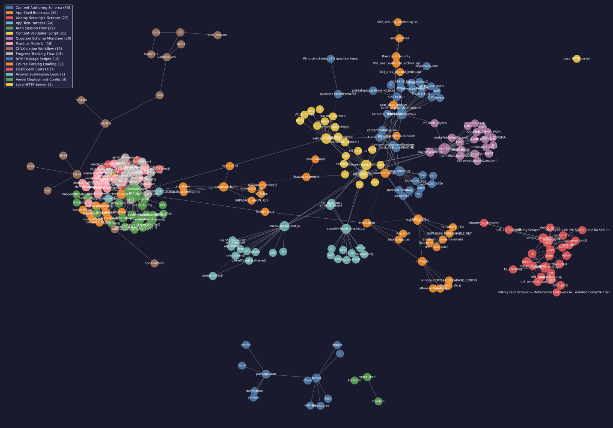

# CertLab Study Blueprint

## System Overview
CertLab Study is a static, catalog-driven certification study workspace and technical writeup reader with username/password authentication and per-user progress archiving through Supabase. The repository combines a browser ES module single-page application (`lib/`), a Vercel serverless runtime configuration endpoint (`api/`), Node.js content authoring, migration, and validation CLI tools (`scripts/`), versioned JSON certification course bundles (`content/`), and PostgreSQL/RLS database migrations (`supabase/`).

## Local Interface & Invariants
- `config.example.js`:
  - `window.CERTLAB_SUPABASE_CONFIG`: Browser-safe template defining `Object.freeze({ url, anonKey })` for local static-server testing when copied to gitignored `config.js`.
- `scrape_securityplus.py`:
  - `chapter_to_domain(chapter_title)`, `clean(s)`, `get_curriculum()`, `get_questions(quiz)`, `save_db(all_q, path='udemy_questions.db')`, `merge_app(all_q, app_path='questions.json')`, `main()`.
- `udemy_scraper.py`:
  - `clean(s)`, `safe_get(url, label='')`, `get_enrolled_courses()`, `get_quizzes(course_id)`, `get_questions(quiz, course_title)`, `save_db(all_q, path='udemy_questions.db')`, `to_domain(quiz_title)`, `merge_into_app(all_q, app_path='questions.json')`, `main()`.
- `debug_api.py`:
  - Standalone diagnostic script (`COOKIES`, `HEADERS`, `COURSE_ID`, `s = requests.Session()`) for inspecting Udemy API v2.0 course and curriculum responses.
- **Local Invariants**:
  - `window.CERTLAB_SUPABASE_CONFIG` in `config.example.js` is frozen via `Object.freeze`.
  - `clean(s)` strips HTML tags (`<[^>]+>`) and trims whitespace; scraped items with empty question prompts or empty answer lists are discarded.
  - `save_db()` enforces `UNIQUE(question, quiz_id)` in local SQLite (`udemy_questions.db`) and inserts via `INSERT OR IGNORE`.
  - `merge_app()` and `merge_into_app()` deduplicate scraped records against `questions.json` by exact prompt string (`q['q']`) in legacy `{ d, q, o, a, e }` format.
- **Local Side Effects**:
  - `scrape_securityplus.py`, `udemy_scraper.py`, and `debug_api.py` issue HTTP `GET` requests to `https://www.udemy.com/api-2.0/*`, write to local SQLite (`udemy_questions.db`) and `questions.json` / `securityplus_raw.json` / `udemy_questions_raw.json`, and both `scrape_securityplus.py` and `udemy_scraper.py` update `index.html` question counts in-place.

## Subdirectories & System Boundaries
- **API Serverless Endpoints**: [./api/README.md](./api/README.md) — Vercel serverless function (`/api/config`) serving validated `SUPABASE_URL` and `anonKey` runtime configuration with `no-store` headers.
- **Frontend Application & Client Library**: [./lib/README.md](./lib/README.md) — Browser ES modules implementing configuration bootstrap, Supabase client setup, SPA state and UI rendering, safe Markdown/TOC rendering, and writeup/article progress sync.
- **Content Authoring, Migration & Validation Scripts**: [./scripts/README.md](./scripts/README.md) — Node.js CLI utilities for scaffolding new courses, importing raw questions and bilingual writeups, migrating legacy Security+ banks, and validating v2 content schemas.
- **Supabase Database Migrations & RLS Schema**: [./supabase/README.md](./supabase/README.md) — Ordered PostgreSQL DDL migrations defining `user_profiles`, `user_data_archive`, `study_articles`, `study_article_progress`, Storage buckets, and Row Level Security policies.
- **Non-Code & Asset Directories** (unlinked boundaries):
  - `content/` — Catalog (`content/catalog.json`), course bundles (`comptia-security-plus-sy0-701`, `comptia-network-plus-n10-009`, `iso-27001-2022`, `aws-cloud-practitioner-clf-c02`, `_TEMPLATE`), and migration reports (`content/reports/`).
  - `assets/` — Static stylesheet (`assets/app.css`).
  - `docs/` — Authoring guide ([./docs/AUTHORING.md](./docs/AUTHORING.md)) and knowledge graph snapshot ([./docs/graph.svg](./docs/graph.svg)).
  - `tests/` — Node.js test runner suite (`*.test.js`).

## Global Invariants
- Never expose or configure a Supabase `service_role` or secret key in `SUPABASE_PUBLISHABLE_KEY`, `SUPABASE_ANON_KEY`, `/api/config`, or browser client bundles; both `/api/config` and `lib/supabase.js` enforce publishable (`sb_publishable_*`) or `role === 'anon'` JWT keys.
- Row Level Security (RLS) on `user_profiles`, `user_data_archive`, and `study_article_progress` restricts client `SELECT`, `INSERT`, and `UPDATE` operations strictly to `auth.uid() = user_id`, and `user_data_archive` payloads are capped at `262,144` bytes (256 KiB) in both client sync and PostgreSQL check constraints.
- Usernames must match `^[a-z0-9][a-z0-9._-]{2,31}$` and are mapped to synthetic internal addresses (`<username>@users.certlab.app`) for Supabase Auth; passwords require at least 12 characters including lowercase, uppercase, number, and symbol.
- All active certification course bundles in `content/catalog.json` must conform to schema version `'2.0'` (`'2.1'` for `objectives.json`), resolve strictly within `content/` without path traversal, and pass `scripts/validate-content.js` before publication.

## Global Side Effects
- Browser client persists study progress and writeup language preferences in `localStorage` (`certlab:progress:<courseId>`, `secplus-progress`, `certlab:writeups:language`) and synchronizes authenticated user state with Supabase Auth and PostgREST (`user_profiles`, `user_data_archive`, `study_articles`, `study_article_progress`).
- Authoring and migration CLI scripts mutate JSON files under `content/`, and `scripts/import-writeups.js --apply` uploads images and article records to Supabase Storage (`writeup-images`) and PostgREST (`study_articles`) using `SUPABASE_SERVICE_ROLE_KEY`.

## System Verification
- Run: `npm test`
- Full CI check: `npm run ci`

---

## Supabase setup

1. Create or open the Supabase project for the URL in `.env.example`.
2. In **Project Settings → API**, copy the browser-safe **publishable key** (or legacy `anon` key). Never use a `service_role` or secret key in this repository.
3. In Vercel, open **Project Settings → Environment Variables** and add:

   ```text
   SUPABASE_URL=https://enpwqvojhqiuryhzujrn.supabase.co
   SUPABASE_PUBLISHABLE_KEY=your_publishable_key
   ```

   Enable the variables for the environments you deploy to, then redeploy. The `/api/config` function reads these variables at runtime.

   For local static-server testing only, copy `config.example.js` to an ignored `config.js` and put the key there:

   ```js
   window.CERTLAB_SUPABASE_CONFIG = Object.freeze({
     url: 'https://enpwqvojhqiuryhzujrn.supabase.co',
     anonKey: 'YOUR_PUBLISHABLE_OR_ANON_KEY'
   });
   ```

   `config.example.js` is a safe template. `config.js` is ignored and must never be committed.

4. Run the migrations **in order** in the Supabase SQL Editor:
   - `supabase/001_user_auth_and_archive.sql` — creates `user_profiles` and `user_data_archive`, enables RLS.
   - `supabase/002_security_hardening.sql` — revokes leaked public function, tightens constraints.
   - `supabase/004_drop_unused_index.sql` — drops the unused `user_data_archive_updated_at_idx` (all queries are point lookups on the primary key).
   - `supabase/006_writeups.sql` — creates `study_articles`, `study_article_progress`, and the public `writeup-images` Storage bucket with RLS policies.
   - `supabase/007_writeups_advisor_fixes.sql` — hardens `study_articles_set_updated_at()` `search_path`, wraps `auth.uid()` in scalar subqueries on `study_article_progress` RLS policies, and adds the `study_article_progress_article_id_idx` foreign-key covering index.
   - `supabase/008_supabase_security_and_index_optimization.sql` — revokes default table/function privileges from `public`, `anon`, and `authenticated`, attaches `user_profiles_updated_at` trigger, adds bounded size/format check constraints and `UNIQUE (slug, language)` on `study_articles`, adds `study_articles_published_list_idx`, and enforces a 5 MiB size limit and image MIME allowlist on the `writeup-images` Storage bucket.
   - `supabase/009_learner_progress_and_password_recovery.sql` — creates normalized learner progress tables (`user_course_progress`, `user_question_progress`, `user_exam_attempts`), attaches `user_data_archive_sync_progress` trigger, and adds self-service password recovery (`user_recovery_credentials`, `password_reset_audit`, `set_user_recovery_code()`, `reset_password_with_recovery_code()`).
5. In **Authentication → Providers → Email**, turn off **Confirm email** for this username-only flow, or confirm newly created users manually. Usernames are mapped to syntactically valid internal addresses (`<username>@users.certlab.app`) because Supabase Auth authenticates email/phone credentials. These synthetic addresses are not mailboxes; accounts generate a 16-character recovery code (`CLAB-XXXX-XXXX-XXXX`, stored as a bcrypt hash) and optionally link a recovery email so users can reset a forgotten password.

The app stores the normal study state in browser `localStorage` for offline resilience, upserts the same state to `user_data_archive` (which automatically synchronizes `user_course_progress` and `user_question_progress`), and records completed timed mock exams in `user_exam_attempts`. Passwords are never stored in plaintext; Supabase Auth and `pgcrypto` bcrypt manage password and recovery-code hashing.

## Password and username rules

- Username: 3–32 lowercase characters, numbers, `.`, `_`, or `-`; must start with a letter or number.
- Password: at least 12 characters and must contain lowercase, uppercase, a number, and a symbol.

## Run locally

Serve the directory over HTTP (ES modules and `fetch()` are not supported reliably from `file://`):

```powershell
python -m http.server 8000
```

Open <http://localhost:8000/>.

## Add a course

Certifications are content, not code. Scaffold a new draft course, add questions,
validate, then publish. See [docs/AUTHORING.md](./docs/AUTHORING.md) for the full guide.

```powershell
node scripts/new-course.js --id iso-27001-2022 --title "ISO/IEC 27001:2022" --provider ISO --code 27001 --category Governance --domains "A.5:Organizational;A.6:People;A.7:Physical;A.8:Technological"
node scripts/import-questions.js --course iso-27001-2022 --in raw-questions.json
npm run validate
```

## Validate

```powershell
npm run ci          # node --check + validate-content + node --test
```

Individual steps:

```powershell
node --check lib/app.js
node --check lib/supabase.js
node scripts/validate-content.js
node --test
```

## Architecture

The map below is a [Graphify](https://github.com/safishamsi/graphify) knowledge graph of this repo: 268 nodes, 494 edges, 16 communities (app shell, auth, practice UI, content schema, validation, and the question-bank migration).



`docs/graph.svg` is the committed snapshot GitHub can render. The interactive graph (`graphify-out/graph.html`) and `GRAPH_REPORT.md` stay local — `graphify-out/` is gitignored.

Rebuild after code changes:

```powershell
graphify update .
graphify export svg
Copy-Item -Force graphify-out\graph.svg docs\graph.svg
```

## Data-security notes

- The publishable/anon key is intended for browser use; it will be visible to a browser after `/api/config` returns it. Supabase security comes from RLS policies, not from hiding this public key.
- Never put a `service_role` or secret key in `SUPABASE_PUBLISHABLE_KEY`.
- RLS policies require `auth.uid() = user_id` for profile and archive reads/writes.
- Do not commit `config.js`, `.env` files, service-role keys, or exported user data.
